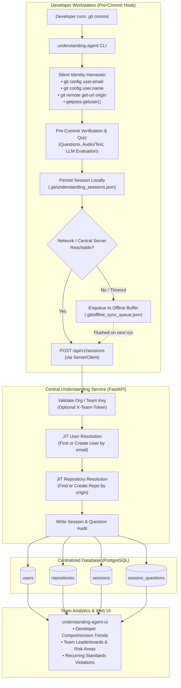
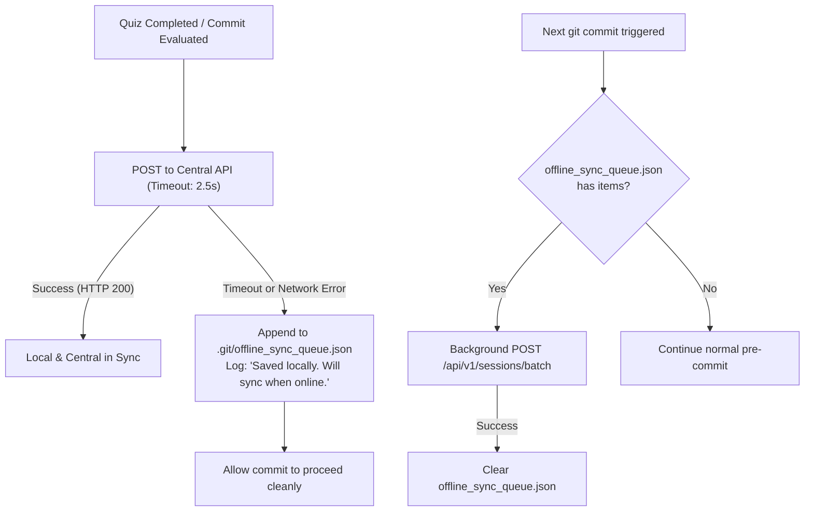

# Centralized Database Architecture & Zero-Touch User Management

This document defines the architectural blueprint and implementation plan for transitioning **Understanding Agent** from decentralized local JSON storage (`.git/understanding_sessions.json`) to a **centralized database**.

It specifically addresses how to track, manage, and report on all developers across teams **without requiring individual developers to manually enter credentials, configure personal access tokens (PATs), or link Git/platform accounts**.

---

## 1. Executive Summary & Design Principles

### The Problem
* **Local Silos**: Today, quiz attempts and standards checks are written to `.git/understanding_sessions.json` on each developer's workstation. Team leads and engineering managers have no aggregate visibility into code comprehension, recurring violations, or team-level metrics.
* **Authentication Friction**: Traditional centralized tools require developers to perform OAuth flows, enter GitHub/GitLab tokens, or log in via CLI. In a pre-commit hook, any authentication friction leads to broken commit workflows, bypassed hooks (`--no-verify`), and poor adoption.

### The Solution
* **Zero-Touch Identity Extraction**: The client hook automatically harvests existing, standard workstation attributes at commit time (`git config user.email`, `git config user.name`, `remote.origin.url`, and OS username).
* **Just-In-Time (JIT) Auto-Provisioning**: The central backend dynamically resolves or registers users and repositories on their very first commit attempt.
* **Hybrid Storage & Offline Resilience**: Commits are never blocked if the central database or network is unreachable. Results are written to a local queue and synced when connectivity resumes.
* **PostgreSQL + JSONB**: Combines relational tables for user and repository metrics with schema-flexible `JSONB` storage for AST summaries, questions, and evaluations.

---

## 2. End-to-End System Architecture



---

## 3. Zero-Touch User Identity Auto-Resolution

Developers **do not need to log in or enter platform tokens**. Git itself mandates author metadata on every commit.

### Identity Extraction Strategy

| Metadata Field | Extraction Source | Fallback Strategy | Example |
| :--- | :--- | :--- | :--- |
| **`user_email`** *(Primary Key)* | `git config user.email` | System username + machine domain | `alex.smith@company.com` |
| **`user_name`** | `git config user.name` | `getpass.getuser()` | `Alex Smith` |
| **`repo_slug`** | `git config --get remote.origin.url` | Folder name of workspace root | `acme-corp/billing-service` |
| **`git_platform`** | Parsed from remote URL hostname | `custom` | `github`, `gitlab`, `bitbucket` |
| **`system_user`** | `getpass.getuser()` | Environment `$USER` / `$USERNAME` | `asmith` |
| **`machine_id`** | Hashed hostname + MAC address | `unknown-host` | `b9f2...81c` |
| **`ci_actor`** | `$GITHUB_ACTOR` / `$GITLAB_USER_LOGIN` | None (empty for local) | `dependabot[bot]` |

### Client-Side Implementation Pattern

This logic is integrated directly into the hook's [`EnvironmentDetector`](file:///Users/liza/Documents/PRE-COMMIT-DEMO/understanding-agent-hook/understanding_agent/environment_detector.py):

```python
import os
import re
import socket
import getpass
import hashlib
import subprocess
from typing import Dict, Any

class IdentityDetector:
    """Extracts zero-touch developer and repository identity without interactive prompts."""

    @staticmethod
    def _run_git(args: list[str], cwd: str) -> str:
        try:
            return subprocess.check_output(
                ["git"] + args, cwd=cwd, text=True, stderr=subprocess.DEVNULL
            ).strip()
        except Exception:
            return ""

    @classmethod
    def resolve(cls, repo_root: str) -> Dict[str, Any]:
        email = cls._run_git(["config", "user.email"], repo_root)
        name = cls._run_git(["config", "user.name"], repo_root) or getpass.getuser()
        remote_url = cls._run_git(["config", "--get", "remote.origin.url"], repo_root)

        # Detect platform from remote origin URL
        platform = "custom"
        if "github.com" in remote_url:
            platform = "github"
        elif "gitlab.com" in remote_url:
            platform = "gitlab"
        elif "bitbucket.org" in remote_url:
            platform = "bitbucket"

        # Parse 'org/repo' from 'git@github.com:org/repo.git' or HTTPS format
        repo_slug = ""
        m = re.search(r"[:/]([^/:]+/[^/:]+?)(?:\.git)?$", remote_url)
        if m:
            repo_slug = m.group(1)
        else:
            repo_slug = os.path.basename(repo_root)

        # Machine fingerprint (to correlate multiple local setups for same user)
        host_hash = hashlib.sha256(socket.gethostname().encode("utf-8")).hexdigest()[:12]

        # CI environment detection
        ci_actor = (
            os.environ.get("GITHUB_ACTOR")
            or os.environ.get("GITLAB_USER_LOGIN")
            or os.environ.get("BITBUCKET_STEP_TRIGGERER_UUID")
            or ""
        )

        # Resilient email fallback
        if not email:
            sys_user = getpass.getuser()
            email = f"{sys_user}@{socket.gethostname().lower()}.local"

        return {
            "user_email": email.lower().strip(),
            "user_name": name.strip(),
            "system_user": getpass.getuser(),
            "machine_id": host_hash,
            "repo_slug": repo_slug,
            "git_platform": platform,
            "remote_url": remote_url,
            "ci_actor": ci_actor,
        }
```

---

## 4. Central Database Schema (PostgreSQL)

The database schema separates **relational entities** (users, repositories, summary counts) for fast querying and indexing from **semi-structured JSON** (`change_summary`, `standards_report`, `questions`) for full historical fidelity.

```sql
-- ============================================================================
-- 1. USERS TABLE (Auto-created via JIT on first commit)
-- ============================================================================
CREATE TABLE users (
    id SERIAL PRIMARY KEY,
    email VARCHAR(255) UNIQUE NOT NULL,
    full_name VARCHAR(255) NOT NULL,
    system_username VARCHAR(100),
    avatar_url VARCHAR(500),
    first_seen_at TIMESTAMP WITH TIME ZONE DEFAULT NOW(),
    last_active_at TIMESTAMP WITH TIME ZONE DEFAULT NOW()
);

CREATE INDEX idx_users_email ON users(email);

-- ============================================================================
-- 2. REPOSITORIES TABLE (Auto-created from git remote)
-- ============================================================================
CREATE TABLE repositories (
    id SERIAL PRIMARY KEY,
    repo_slug VARCHAR(255) UNIQUE NOT NULL, -- e.g. 'acme/billing-service'
    platform VARCHAR(50) DEFAULT 'github',  -- 'github', 'gitlab', 'internal'
    remote_url TEXT,
    default_branch VARCHAR(100) DEFAULT 'main',
    created_at TIMESTAMP WITH TIME ZONE DEFAULT NOW()
);

CREATE INDEX idx_repositories_slug ON repositories(repo_slug);

-- ============================================================================
-- 3. SESSIONS TABLE (Pre-commit quiz & compliance attempts)
-- ============================================================================
CREATE TABLE sessions (
    id SERIAL PRIMARY KEY,
    session_id VARCHAR(100) UNIQUE NOT NULL,
    user_id INT REFERENCES users(id) ON DELETE SET NULL,
    repo_id INT REFERENCES repositories(id) ON DELETE CASCADE,
    branch VARCHAR(255) NOT NULL,
    commit_hash VARCHAR(64),
    head_commit VARCHAR(64),
    diff_hash VARCHAR(64),
    attempt_number INT DEFAULT 1,
    status VARCHAR(20) NOT NULL,            -- 'PASSED', 'FAILED'
    verification VARCHAR(50) DEFAULT 'llm', -- 'llm', 'llm-unverified', 'gate-blocked'
    score NUMERIC(5, 2) DEFAULT 0.0,
    violations_count INT DEFAULT 0,
    machine_id VARCHAR(50),
    changed_files JSONB DEFAULT '[]'::jsonb,
    change_summary JSONB DEFAULT '{}'::jsonb,
    standards_report JSONB DEFAULT '[]'::jsonb,
    created_at TIMESTAMP WITH TIME ZONE DEFAULT NOW()
);

CREATE INDEX idx_sessions_user_id ON sessions(user_id);
CREATE INDEX idx_sessions_repo_id ON sessions(repo_id);
CREATE INDEX idx_sessions_created_at ON sessions(created_at DESC);
CREATE INDEX idx_sessions_status ON sessions(status);

-- ============================================================================
-- 4. SESSION QUESTIONS TABLE (Per-question evaluation audit)
-- ============================================================================
CREATE TABLE session_questions (
    id SERIAL PRIMARY KEY,
    session_id INT REFERENCES sessions(id) ON DELETE CASCADE,
    question_id VARCHAR(100),
    question_text TEXT NOT NULL,
    answer_text TEXT,
    score NUMERIC(5, 2),
    category VARCHAR(100),                  -- 'architecture', 'security', 'intent'
    evaluation_feedback TEXT,
    answered_in_attempt INT,
    llm_verified BOOLEAN DEFAULT TRUE,
    created_at TIMESTAMP WITH TIME ZONE DEFAULT NOW()
);

CREATE INDEX idx_session_questions_session_id ON session_questions(session_id);
```

---

## 5. Server-Side JIT Provisioning Logic

When a developer finishes a pre-commit defense session, [`ServerClient`](file:///Users/liza/Documents/PRE-COMMIT-DEMO/understanding-agent-hook/understanding_agent/server_client.py) transmits the payload to `POST /api/v1/sessions`.

The API handles registration and session persistence in an atomic transaction:

```python
from fastapi import FastAPI, HTTPException, Depends, Header
from sqlalchemy.orm import Session
from sqlalchemy import func

@app.post("/api/v1/sessions")
def record_session(
    payload: dict,
    db: Session = Depends(get_db_session),
    x_team_token: str | None = Header(None)
):
    # 1. Authenticate the Project/Team (Shared token, not individual password)
    if EXPECTED_TEAM_TOKEN and x_team_token != EXPECTED_TEAM_TOKEN:
        raise HTTPException(status_code=401, detail="Invalid team token")

    identity = payload.get("identity", {})
    email = identity.get("user_email", "unknown@local.dev").lower().strip()
    name = identity.get("user_name", "Developer")
    repo_slug = identity.get("repo_slug", "unknown/repo")

    # 2. JIT User Resolution (No signup, auto-provision on first commit)
    user = db.query(User).filter(User.email == email).first()
    if not user:
        user = User(
            email=email,
            full_name=name,
            system_username=identity.get("system_user"),
            first_seen_at=func.now(),
            last_active_at=func.now()
        )
        db.add(user)
        db.flush()
    else:
        user.last_active_at = func.now()
        if name and user.full_name != name:
            user.full_name = name

    # 3. JIT Repository Resolution
    repo = db.query(Repository).filter(Repository.repo_slug == repo_slug).first()
    if not repo:
        repo = Repository(
            repo_slug=repo_slug,
            platform=identity.get("git_platform", "custom"),
            remote_url=identity.get("remote_url", "")
        )
        db.add(repo)
        db.flush()

    # 4. Save Session Record
    session_row = QuizSession(
        session_id=payload.get("session_id"),
        user_id=user.id,
        repo_id=repo.id,
        branch=payload.get("branch", "unknown"),
        commit_hash=payload.get("commit_id") or payload.get("head_commit"),
        head_commit=payload.get("head_commit"),
        diff_hash=payload.get("diff_hash"),
        attempt_number=payload.get("attempt_number", 1),
        status=payload.get("status", "FAILED"),
        verification=payload.get("verification", "llm"),
        score=payload.get("score", 0.0),
        violations_count=payload.get("violations_count", 0),
        machine_id=identity.get("machine_id"),
        changed_files=payload.get("changed_files", []),
        change_summary=payload.get("change_summary", {}),
        standards_report=payload.get("standards_report", [])
    )
    db.add(session_row)
    db.flush()

    # 5. Save Granular Questions & Answers
    for q in payload.get("questions", []):
        eval_obj = q.get("evaluation") or {}
        q_row = SessionQuestion(
            session_id=session_row.id,
            question_id=q.get("question_id"),
            question_text=q.get("question", ""),
            answer_text=q.get("answer", ""),
            score=eval_obj.get("score") or q.get("score", 0),
            category=q.get("category", "general"),
            evaluation_feedback=eval_obj.get("evaluation", ""),
            answered_in_attempt=q.get("answered_in_attempt", 1),
            llm_verified=eval_obj.get("llm_verified", True)
        )
        db.add(q_row)

    db.commit()
    return {"status": "success", "session_id": session_row.session_id, "user_id": user.id}
```

---

## 6. Offline-First Resilience (Client-Side Queue)

Developers may commit while in offline environments (airplanes, train transit, VPN drops).  
**Rule**: Network connectivity issues to the central database must **never block or fail a developer's commit**.

### Client Sync Engine

1. **Primary Attempt**: The client sends the payload with a 2.5-second timeout.
2. **Fallback Queue**: If the network connection drops or times out:
   - The payload is appended to `.git/offline_sync_queue.json`.
   - The commit proceeds unimpeded.
3. **Automatic Re-sync**: Every time the hook runs, it first inspects `.git/offline_sync_queue.json`. If populated and connectivity is restored, it drains the queue via batch POST (`POST /api/v1/sessions/batch`).



---

## 7. Security & Anti-Spoofing Without User Logins

Without individual username/password prompts, how do we guarantee data authenticity?

1. **Team / Repository Secret**:
   - Set one shared token: `UNDERSTANDING_AGENT_TEAM_KEY=xyz` in the repository `.env` or CI secret store.
   - Individual engineers do not manage credentials; the repository itself holds the authorization to write to the telemetry API.
2. **Private Network Boundaries**:
   - Host the central API inside your corporate VPN, Tailscale mesh, or behind Cloudflare Access with a service token.
3. **Git Author Validation (Optional)**:
   - The server can verify that `user_email` matches approved organizational domains (e.g. `@company.com`).
   - If commits are signed (`git commit -S`), the client can forward the commit signature (`git log -1 --show-signature`) for cryptographic verification against public keys registered with the company.

---

## 8. Migration Plan & Step-by-Step Rollout

### Phase 1: Client Metadata Enrichment (Hook Package)
* Enhance [`understanding_agent/environment_detector.py`](file:///Users/liza/Documents/PRE-COMMIT-DEMO/understanding-agent-hook/understanding_agent/environment_detector.py) with the `IdentityDetector` logic.
* Ensure all session payloads constructed in [`cli.py`](file:///Users/liza/Documents/PRE-COMMIT-DEMO/understanding-agent-hook/understanding_agent/cli.py) attach the `identity` dict.
* Add unit tests verifying fallback behavior when `user.email` is absent.

### Phase 2: Central Database & Ingestion Service
* Deploy PostgreSQL and apply the schema migration.
* Implement the FastAPI endpoints (`/api/v1/sessions` and `/api/v1/sessions/batch`).
* Add automated tests for JIT user creation and duplicate session idempotency.

### Phase 3: Client Dual-Write & Offline Queue
* Update [`ServerClient`](file:///Users/liza/Documents/PRE-COMMIT-DEMO/understanding-agent-hook/understanding_agent/server_client.py) to implement the local offline queue in `.git/offline_sync_queue.json`.
* Enable dual-writing: write to the local `.git/understanding_sessions.json` (for local instant history) while transmitting to the central service.

### Phase 4: Historical Data Backfill CLI
* Provide a built-in CLI utility to sync past local commits:
  ```bash
  understanding-agent sync-history --server https://understanding-agent.internal.company.com
  ```
  This reads the existing `.git/understanding_sessions.json`, resolves commit authors via `git show -s --format='%ae|%an'`, and pushes past records to the central database.

### Phase 5: Dashboard Upgrade
* Update [`understanding_agent/server.py`](file:///Users/liza/Documents/PRE-COMMIT-DEMO/understanding-agent-hook/understanding_agent/server.py) and [`understanding_agent/ui/app.js`](file:///Users/liza/Documents/PRE-COMMIT-DEMO/understanding-agent-hook/understanding_agent/ui/app.js) so the UI queries the central database instead of the local filesystem.
* Introduce views for:
  - **Developer Drill-Down**: Individual comprehension progression and score distributions.
  - **Repository Matrix**: High-risk modules and frequent standards violations.
  - **Team Leaderboard**: Most thorough pre-commit defenses and highest comprehension scores.

---

## 9. AMENDMENTS (implemented — Pokerface P3, PLAN_POKERFACE_JUDAS.md)

This blueprint was adopted and implemented in `service/` (FastAPI +
SQLAlchemy). The amendments below are deltas from the original document,
each with its reason.

### 9.1 Org hierarchy above users/repositories

The original schema had users/repos/sessions but no team dimension, so
"per team" queries were impossible. Implemented (service/models.py):

    organizations 1..* teams 1..* team_members *..* users
    repositories.team_id → teams.id

Resolution chain per session: identity.email → user (JIT) ;
identity.repo_slug → repo (JIT) → team → org. Per-developer = user_id,
per-repo = repo_id, per-team = repo.team_id. Team membership is managed via
`POST /api/v1/admin/members`; repo→team assignment via
`POST /api/v1/admin/repositories` (both X-Admin-Token guarded).

### 9.2 Anti-spoofing upgraded from shared token to token + HMAC

Shared token alone (section 7) proves only "someone in the team". Implemented:
`X-Team-Token` (SERVICE_TEAM_TOKEN) PLUS `X-Signature` — HMAC-SHA256 over the
canonical payload (sorted keys, no whitespace) with UNDERSTANDING_AGENT_TEAM_SECRET,
verified server-side with compare_digest. Ceiling unchanged and stated
honestly: this proves "someone holding the team secret", not "this developer
answered honestly". Per-developer cryptographic attestation is deferred
deliberately (not worth it pre-adoption).

### 9.3 Privacy, retention, and the HR question (was missing entirely)

Answers are developer-performance data — adoption dies in an HR review
without an explicit stance. Implemented policy:

- Raw answer text retained SERVICE_RETENTION_DAYS (default 90), then nulled
  by `purge_expired_answers` (scores/aggregates kept forever).
- Per-developer score trends and drill-downs are HR-adjacent: the dashboard
  side (deferred, P4) must default them OFF; individual views are team
  opt-in.
- `machine_id` is a one-way hash of the hostname (12 hex chars) — correlation
  only, never a raw hostname.

### 9.4 Local tier: SQLite, not JSON

The original design kept plaintext JSON locally. Amended per product
decision: the local store is SQLite (`.git/understanding_sessions.db`,
0600 perms — developer answers are personal data; plaintext JSON readable
by anyone was rejected). The legacy JSON file is imported once on first
open and renamed `.imported` (backup, never deleted). JSON remains an
export format (`session_store.export_sessions`). Public API
(save/load/get_sessions_for_commit/get_session_by_id) is unchanged.

### 9.5 Client transport (server_client.py)

- UNDERSTANDING_AGENT_SYNC_URL (base URL) activates queue-backed sync:
  single-session POST to /api/v1/sessions; on failure the payload is
  queued in `.git/understanding_sync_queue.json` (0600) and drained as a
  batch on the next hook run. Commit is never blocked or slowed beyond the
  2.5s sync budget.
- UNDERSTANDING_AGENT_TELEMETRY_URL remains as the legacy single-endpoint
  transport (unchanged behavior, no queue).
- Verified end-to-end live (2026-10-16): hook → service → ledger, offline
  queue, restart drain — all sessions present, queue empty.

### 9.6 New actor classes (Judas J2)

The original flow assumed a human at the terminal. The hook now models
agents as first-class unverified actors: UNDERSTANDING_AGENT_MODE=agent (or
an unreachable TTY) skips the oral defense, records
verification=agent-unverified / unattended-unverified, exits 0. The
credential gate still hard-blocks. See docs/ENFORCEMENT.md for how CI uses
these rows.

### 9.7 Enforcement tie-in (Judas)

GET /api/v1/defense?repo_slug=&from=&to= serves proof-of-defense rows
(commit/diff hash, status, verification, developer email). CI/pre-receive
calls it per commit in the push range (scripts/verify_defense.py):
a pushed commit with no PASSED session row is unaudited by definition.
This makes the ledger an enforcement primitive, not just analytics.
